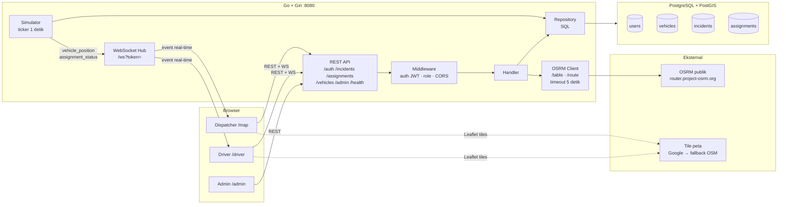
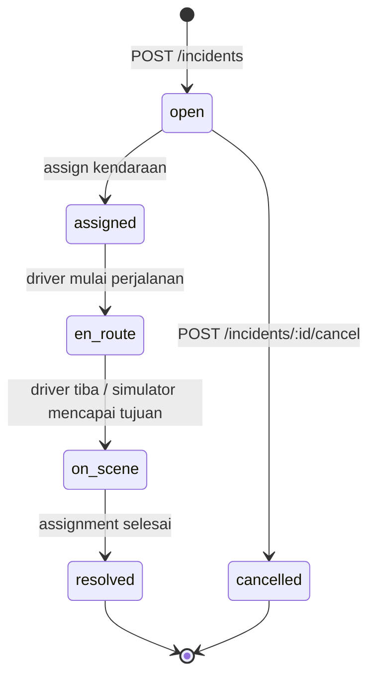
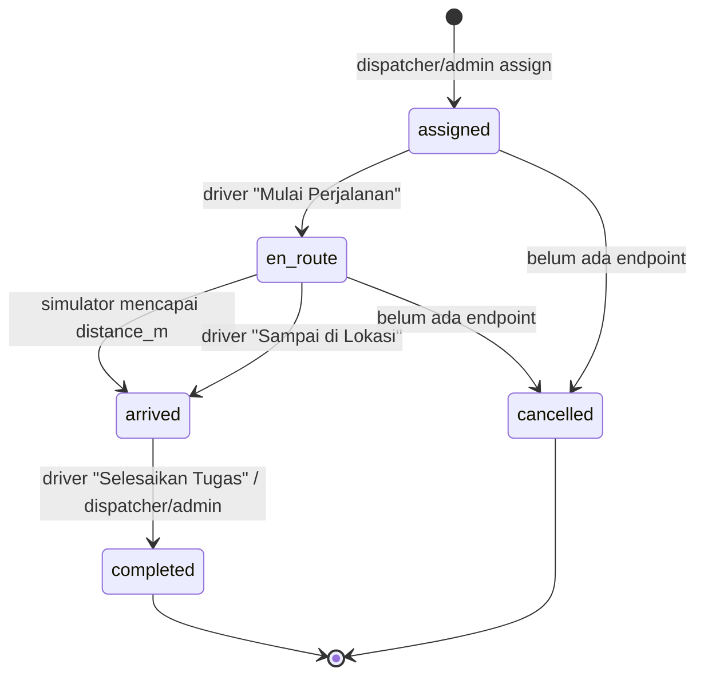

# Arsitektur Dispatch

Dokumen ini menjelaskan komponen, alur data, keputusan desain yang sudah ada, dan keterbatasan MVP Dispatch. Untuk aturan domain yang lebih rinci, lihat [`AGENT.md`](../AGENT.md). Untuk backlog, lihat [`BACKLOG.md`](BACKLOG.md).

## 1. Gambaran komponen



### Tanggung jawab lapisan

| Lapisan | Lokasi | Tanggung jawab |
| --- | --- | --- |
| Entrypoint | `cmd/server` | Load config, buka pool DB, wiring router, start/stop simulator, graceful shutdown. |
| Migrasi | `cmd/migrate` + `migrations/` | Menjalankan SQL berurutan, mencatat versi di `schema_migrations`. |
| Seed/reset | `cmd/seed`, `cmd/resetdemo` | Data demo deterministik; reset tanpa menghapus seed baseline. |
| Router | `internal/router` | Registrasi endpoint, middleware, wiring handler, WebSocket, simulator. |
| Handler | `internal/handler` | Validasi request, otorisasi level endpoint, orkestrasi repository/OSRM, format response/error. |
| Repository | `internal/repository` | Query SQL dan pemetaan baris ke model. |
| Domain model | `internal/model` | Struct JSON yang dipakai API dan WebSocket. |
| Auth | `internal/auth` | Generate/parse JWT HS256. |
| Middleware | `internal/middleware` | Validasi Bearer token, role, CORS. |
| OSRM | `internal/osrm` | Client `/table` (kandidat) dan `/route` (assignment). |
| Simulator | `internal/simulation` | Menggerakkan kendaraan `en_route`, menghitung progress/ETA, broadcast event. |
| WebSocket | `internal/ws` | Hub broadcast global; autentikasi token saat handshake. |
| Frontend | `frontend/src` | UI dispatcher, driver, admin; REST client; Leaflet; tema. |

## 2. Model data inti

- `users` — `role` (`admin`, `dispatcher`, `driver`), `operating_city` nullable, `password_hash` bcrypt.
- `vehicles` — `type` (`ambulance`, `fire`, `police`), `status`, `driver_id`, `pos_geom`, `home_geom`, `operating_city`.
- `incidents` — titik `geom`, `type`, `priority`, `status`, `created_by`, `operating_city`, `resolved_at`.
- `assignments` — relasi insiden-kendaraan, `assigned_by`, `route_geom` (LineString), `distance_m`, `eta_seconds`, `progress_m`, status, timestamp.

Semua geometri memakai SRID **4326**. API menurunkan `lat`/`lng` dengan `ST_Y`/`ST_X`. Index spasial GiST dipasang untuk posisi kendaraan dan titik insiden.

### Status legal

```text
vehicles:    available | assigned | en_route | on_scene | offline
incidents:   open | assigned | en_route | on_scene | resolved | cancelled
assignments: assigned | en_route | arrived | completed | cancelled
```

Sumber kebenaran transisi ada di `internal/state`. Nilai string di paket tersebut harus sama dengan `CHECK` di migrasi; jangan menambah status baru tanpa migrasi baru dan pembaruan dokumen.

Partial unique index `uniq_active_assignment_per_vehicle` mencegah lebih dari satu assignment aktif (`assigned`, `en_route`) per kendaraan. Status `arrived` dianggap aktif oleh kebijakan aplikasi (bukan oleh index).

## 3. Alur data utama

### 3.1 Pembuatan insiden

1. Dispatcher/admin mengirim `POST /incidents` dengan `lat`, `lng`, `title`, `description`, `type`, `priority`.
2. Handler memvalidasi koordinat berada di Indonesia, tipe, prioritas, dan identitas JWT.
3. Server menentukan `operating_city` dari kendaraan `available` terdekat dalam `DISPATCH_RADIUS_M` (PostGIS `ST_DWithin`). **Client tidak boleh mengirim `operating_city`.**
4. Insiden disimpan dengan status `open`; bila tidak ada kendaraan dalam radius, `operating_city = NULL`.
5. Server broadcast `incident_status` ke klien WebSocket.

### 3.2 Pencarian kandidat

1. `GET /incidents/:id/nearest` hanya untuk insiden `open`.
2. Repository mengambil kendaraan `available` dengan kota yang sama dan posisi dalam radius.
3. Bila kosong → `200` dengan `candidates: []` dan `reason: "no_available_vehicle_within_radius"`.
4. OSRM `/table` menghitung durasi/jarak dari setiap kendaraan ke insiden.
5. Kandidat tanpa durasi/jarak valid dibuang, diurutkan durasi lalu jarak, maksimal 3.
6. Bila OSRM gagal → `502`; **tidak ada fallback jarak garis lurus**.

Tipe kendaraan bukan filter keras; `type_match` hanya penanda.

### 3.3 Assignment driver

1. Dispatcher/admin mengirim `POST /incidents/:id/assign` dengan `{vehicle_id}`.
2. Handler memvalidasi: insiden `open` dan punya `operating_city`; kendaraan `available` dan kota sama; identitas JWT ada.
3. OSRM `/route` mengambil geometri, jarak, dan durasi.
4. Dalam satu transaksi: insert assignment (`assigned`), update kendaraan → `assigned`, update insiden → `assigned`.
5. Pelanggaran unique constraint aktif dipetakan ke `409`; kegagalan lain rollback dan `500`.
6. Setelah commit, server broadcast `assignment_status` berisi assignment + insiden + kendaraan.

`assigned_by` selalu diambil dari JWT tervalidasi, tidak pernah dari body.

### 3.4 State machine eksplisit

Sumber kebenaran transisi ada di `internal/state` (`IncidentTransitions`, `AssignmentTransitions`, `CanTransition`, `CanTransitionAssignment`, `ValidateTransition`, `ValidateAssignmentTransition`). Nilai status tetap sama dengan `CHECK` di migrasi; paket ini tidak menambah status, tabel, atau endpoint.

#### Insiden



| Dari | Tujuan legal | Pemicu |
| --- | --- | --- |
| `open` | `assigned` | `POST /incidents/:id/assign` |
| `open` | `cancelled` | `POST /incidents/:id/cancel` |
| `assigned` | `en_route` | `POST /assignments/:id/start` |
| `en_route` | `on_scene` | `POST /assignments/:id/arrive` atau simulator |
| `on_scene` | `resolved` | `POST /assignments/:id/complete` |

#### Assignment



| Dari | Tujuan legal | Pemicu |
| --- | --- | --- |
| `assigned` | `en_route` | `POST /assignments/:id/start` |
| `assigned` | `cancelled` | Belum ada endpoint; disiapkan untuk fase cancel/reject |
| `en_route` | `arrived` | Simulator atau `POST /assignments/:id/arrive` |
| `en_route` | `cancelled` | Belum ada endpoint; disiapkan untuk fase cancel/reject |
| `arrived` | `completed` | `POST /assignments/:id/complete` |

Aturan penerapan:

- Handler memvalidasi transisi assignment dan insiden sebelum update. Transisi ilegal → `409` dengan format error standar dan data tidak diubah.
- `POST /assignments/:id/start` memvalidasi assignment `assigned → en_route` dan insiden `assigned → en_route`.
- `POST /assignments/:id/arrive` memvalidasi assignment `en_route → arrived` dan insiden `en_route → on_scene`.
- `POST /assignments/:id/complete` memvalidasi assignment `arrived → completed` dan insiden `on_scene → resolved`.
- Simulator memakai tabel transisi yang sama. Bila state tidak konsisten, update dilewati dan dicatat ke log.
- Pembuatan insiden dan assignment hanya menerima status awal `open` dan `assigned`.
- `POST /assignments/:id/start` hanya untuk driver pemilik kendaraan.
- `POST /assignments/:id/arrive` adalah fallback manual driver pemilik kendaraan; simulator biasanya sudah menandai `arrived` otomatis.
- `POST /assignments/:id/complete` boleh oleh driver pemilik, dispatcher, atau admin.
- Complete mengubah kendaraan → `available` di lokasi insiden, dan insiden → `resolved` dengan `resolved_at`.
- Setiap perubahan mengirim `assignment_status`; arrive/complete juga mengirim `incident_status`.
- `cancelled` assignment ada di status legal dan tabel transisi, tetapi belum ada endpoint cancel/reject assignment di MVP. Jangan menambah endpoint tanpa keputusan desain dan aturan kompensasi kendaraan/insiden.

### 3.5 Simulasi dan real-time

- Simulator berjalan di proses backend dengan ticker 1 detik.
- Setiap tick mengambil assignment `en_route`, menambah `progress_m`, dan menghitung posisi.
- Saat `progress_m >= distance_m`, assignment → `arrived`, kendaraan → `on_scene`, insiden → `on_scene`.
- Event `vehicle_position` berisi `vehicle_id`, `assignment_id`, `lat`, `lng`, `progress_pct`, `eta_remaining_seconds`.
- Event `assignment_status` berisi `{assignment, incident, vehicle}`.
- Broadcast bersifat global; frontend memfilter event yang relevan.
- Channel broadcast penuh → event di-drop dan dicatat ke log (tidak memblokir request HTTP).

### 3.6 Integrasi eksternal

| Layanan | Dipakai untuk | Kegagalan |
| --- | --- | --- |
| OSRM `/table` | Peringkat kandidat berdasarkan durasi/jarak. | `502`; tidak ada fallback. |
| OSRM `/route` | Geometri, jarak, ETA assignment. | `502`; assignment tidak dibuat. |
| Tile Google publik | Basemap Leaflet tanpa API key. | Fallback otomatis ke OpenStreetMap. |

OSRM memakai urutan koordinat **lng,lat** dan timeout 5 detik.

## 4. Keputusan desain yang sudah ada

| Keputusan | Alasan |
| --- | --- |
| Assign manual tepat satu kendaraan dari maksimal 3 kandidat | Dispatcher memegang konteks lapangan; sistem tidak mengasumsikan "terdekat = terbaik". |
| Satu assignment aktif per kendaraan lewat partial unique index | Mencegah race condition antar dispatcher di level database. |
| Dispatch lokal per `operating_city` | Menghindari assignment lintas kota yang tidak realistis untuk MVP. |
| `operating_city` insiden ditentukan server | Mencegah client memalsukan kota dan melewati aturan dispatch. |
| OSRM publik, tanpa fallback Euclidean | Menghindari ETA/jarak palsu; lebih baik gagal jelas dengan `502`. |
| `type_match` penanda, bukan filter | Kendaraan lintas tipe tetap bisa dipakai bila konteks memungkinkan. |
| Tiba otomatis oleh simulator + aksi manual sebagai fallback | Simulasi demo tetap berjalan tanpa interaksi, tetapi driver tetap bisa mengoreksi status. |
| Kendaraan tetap di lokasi insiden setelah selesai | Mencerminkan posisi aktual; dispatcher bisa melihat kendaraan tersedia di lapangan. |
| Tanpa Docker, semua lokal | Memudahkan demo/portofolio dan debugging tanpa lapisan container. |
| Frontend tanpa data mock | Semua state operasional berasal dari REST/WebSocket. |
| Tema per peran + override `localStorage` | Dispatcher sering di ruang redup; driver/admin di lapangan. |

## 5. Keterbatasan saat ini

- **State machine terpusat sudah ada** di `internal/state` dan dipakai handler, repository, serta simulator. Status `cancelled` assignment belum punya endpoint, dan transisi assignment belum dijaga secara atomik di level database (validasi handler dapat kalah oleh race condition).
- **Belum ada audit log domain** (siapa mengubah apa dan kapan) selain kolom timestamp/`assigned_by`.
- **Belum ada metrik/monitoring** (Prometheus, tracing, health detail); logging masih teks ke stdout.
- **Belum ada timeout assignment atau auto-reassignment** bila driver tidak merespons.
- **Belum ada crash recovery** untuk assignment `en_route` saat proses restart; simulator hanya memproses state yang ada di DB.
- **Belum ada rate limiting** pada endpoint sensitif (`/auth/login`, assign, admin).
- **Belum ada OpenAPI/Swagger**; kontrak API hanya didokumentasikan di README/AGENT.
- **Test backend masih terbatas**: smoke test JWT, unit test state machine, dan test guard transisi handler; belum ada integration/e2e dan test frontend.
- **CI belum ada**; lint/format/test masih dijalankan manual.
- **Simulasi posisi memakai interpolasi linear** antara posisi kendaraan dan insiden, bukan interpolasi sepanjang `route_geom`. Polyline rute tetap dikirim ke frontend untuk visualisasi.
- **`progress_m` disimpan setiap tick** melalui query update; belum ada batching/optimasi khusus.
- **WebSocket broadcast global**; belum ada room per kota/role.
- **Basemap memakai tile Google publik tidak resmi**; bukan untuk produksi.
- **Admin assignment list belum tersedia**: `frontend/src/api/client.ts` masih mengekspor `fetchAdminAssignments` ke `/admin/assignments`, tetapi endpoint itu belum ada di router. Fungsi tersebut saat ini tidak dipakai UI.
- **Belum ada lisensi** yang dipilih; lihat TODO di README.

## 6. Titik ekstensi yang disarankan

Prioritas dan rincian ada di [`BACKLOG.md`](BACKLOG.md). Urutan yang paling masuk akal:

1. Audit log domain.
2. Timeout/auto-reassignment + crash recovery.
3. Metrik/monitoring dan health detail.
4. Rate limiting endpoint sensitif.
5. OpenAPI + test integration/e2e.
6. CI lint/format/test.

Perubahan besar pada poin-poin di atas harus dibahas dengan pemilik proyek terlebih dahulu (lihat bagian "Berhenti dan tanya" di `AGENTS.md`).
